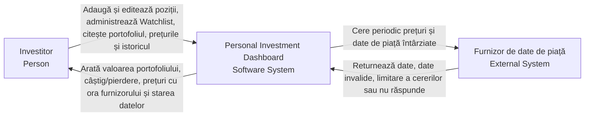
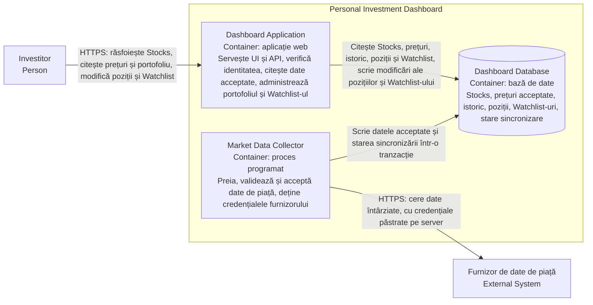
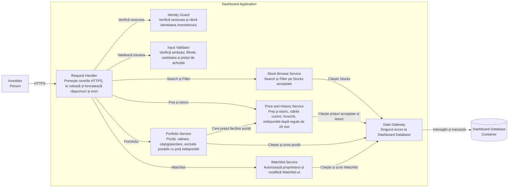
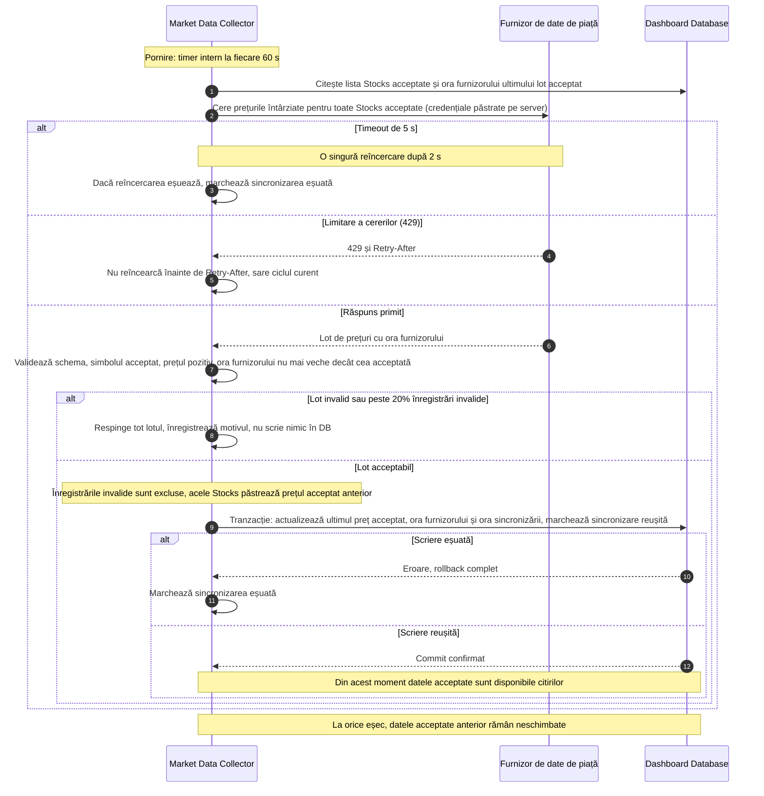
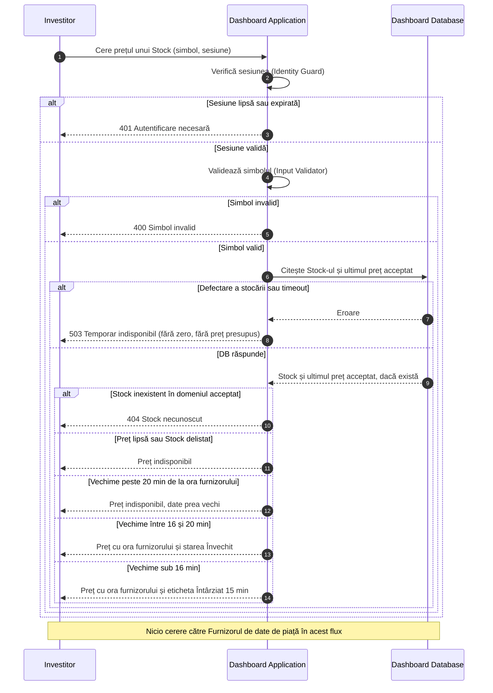
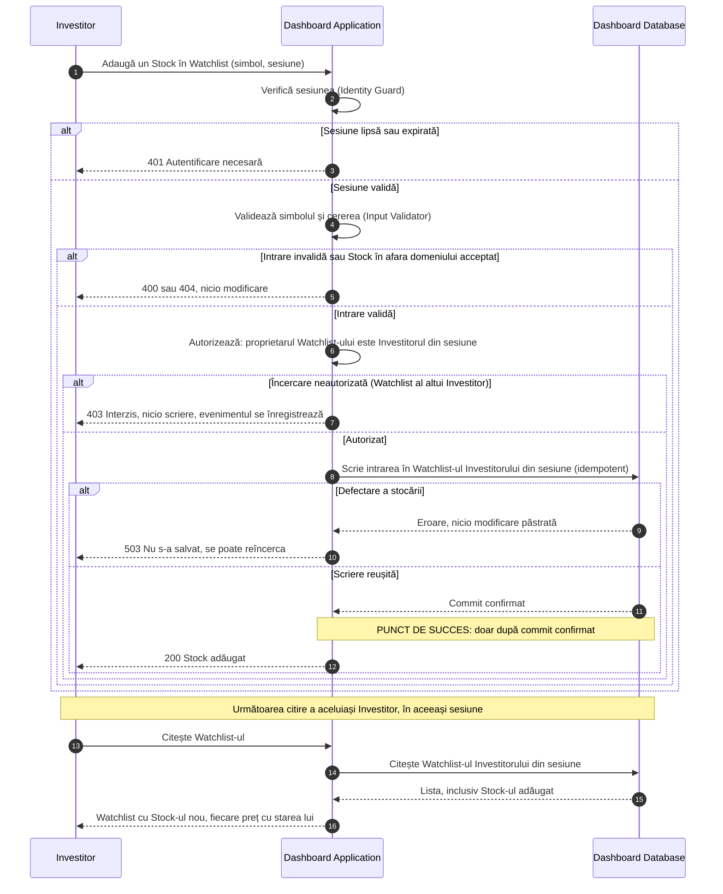

# Laboratorul 3: Desenează limita Dashboard-ului — Soluție

## 1. Diagrama System Context

**Explicație:** diagrama arată sistemul ca o singură cutie, cu cine îl folosește și cu ce sistem extern comunică. Investitorul citește și modifică datele, iar Furnizorul de date de piață trimite prețurile întârziate. Furnizorul poate răspunde cu date invalide, poate limita cererile sau poate să nu răspundă, de aceea relația este etichetată cu toate aceste rezultate. Părțile interne nu apar.

---

## 2. Diagrama Container

**Explicație:** limita sistemului este deschisă și apar trei containere, fiecare cu o singură responsabilitate. Dashboard Application servește Investitorul. Market Data Collector este singurul care vorbește cu furnizorul și păstrează credențialele acestuia. Dashboard Database ține datele acceptate și datele private. Cele două aplicații comunică doar prin baza de date, deci o citire a Investitorului nu cere niciodată o cerere nouă către furnizor, iar o defectare a furnizorului nu oprește răsfoirea.

---

## 3. Diagrama Component (Dashboard Application)

**Explicație:** se deschide numai Dashboard Application și se arată responsabilitățile principale din interiorul ei: primirea cererilor, verificarea identității și a intrării, citirea Stocks și a prețurilor, administrarea portofoliului și a Watchlist-ului, accesul la date. Doar Investitorul și Dashboard Database comunică direct cu aceste componente. Market Data Collector și furnizorul nu apar, deoarece Collector este container lansat separat, iar furnizorul nu comunică direct cu aplicația.

---

## 4. Diagrame de secvență

### A. Sincronizează datele de piață

**Explicație:** fluxul arată cum ajung datele noi în sistem. Un timer pornește sincronizarea, Collector cere datele, le validează și le scrie în bază într-o singură tranzacție. Timeout-ul, limitarea cererilor, datele invalide și defectarea bazei sunt tratate fără a modifica datele acceptate anterior. Datele noi devin vizibile abia după commit.

**Ipoteze:**

- Sincronizarea rulează la 60 s pentru toate cele 5,700 Stocks, într-un singur lot. Furnizorul oferă date întârziate cu aproximativ 15 min, deci o frecvență mai mare nu aduce date mai noi.
- Datele devin vizibile citirilor **numai după commit**. Un lot parțial scris nu este vizibil.
- Sunt invalide: simbol necunoscut, preț lipsă sau mai mic sau egal cu zero, schemă greșită, oră a furnizorului mai veche decât cea deja acceptată. Peste 20% invalide, tot lotul este respins.
- **La eșec** (timeout, limitare, lot invalid, defectare a bazei), datele acceptate anterior rămân neschimbate. Ele se servesc mai departe cu eticheta potrivită vechimii (curent, învechit, apoi indisponibil după 20 min). Nu se înlocuiește nimic cu zero.
- Cheia furnizorului există doar în mediul Market Data Collector. Nu ajunge în browser, în Dashboard Application sau în răspunsuri.
- Eșecurile se înregistrează în log și în starea sincronizării.

---

### B. Citește prețul unui Stock

**Explicație:** fluxul arată ce se întâmplă când Investitorul cere un preț. Se verifică întâi identitatea și simbolul, apoi se citește ultimul preț acceptat din bază. Rezultatul afișat depinde de vechimea lui: curent, învechit sau indisponibil. Lipsa prețului sau o defectare a stocării dau un rezultat explicit, niciodată zero. Citirea nu apelează furnizorul.

**Ipoteze:**

- **O citire a Investitorului NU cere o cerere nouă către furnizor.** Citește doar ultimul preț acceptat din Dashboard Database, scris de Market Data Collector.
- Un preț este acceptat pentru afișare cel mult 20 min de la ora furnizorului, altfel este indisponibil. Pragul de 16 min separă „curent" de „învechit" (15 min întârziere normală plus un ciclu de sincronizare de 60 s).
- Fiecare preț afișat poartă ora furnizorului. Lipsa unui preț nu se afișează ca zero, iar un preț vechi nu se prezintă ca fiind curent.
- Același tipar se aplică fiecărei poziții din portofoliu: o poziție cu preț indisponibil este arătată explicit și exclusă din total, iar restul portofoliului rămâne vizibil.
- O defectare a stocării dă 503, nu un rezultat inventat.

---

### C. Modifică un Watchlist privat

**Explicație:** fluxul arată cum se modifică în siguranță o listă privată. Se verifică în ordine identitatea, intrarea și permisiunea, abia apoi se scrie în bază. O încercare asupra listei altui Investitor este respinsă. Succesul se raportează doar după ce scrierea este confirmată, iar următoarea citire a aceluiași Investitor arată modificarea.

Operația exemplu: adăugarea unui Stock în Watchlist-ul propriu. Eliminarea urmează același flux.

**Ipoteze:**

- Identitatea proprietarului vine **numai din sesiune**, nu din parametrii cererii. Dacă cererea indică Watchlist-ul altui Investitor, răspunsul este 403 și nu se scrie nimic.
- Verificările se fac în ordinea: identitate, intrare, permisiune, scriere.
- Succesul se raportează **doar după commit confirmat**. La defectare, Investitorul primește eroare, nu succes, și nu rămâne o modificare parțială.
- Adăugarea este idempotentă: același Stock adăugat a doua oară nu creează duplicat și nu dă eroare.
- După un succes confirmat, următoarea citire a aceluiași Investitor, în aceeași sesiune, arată modificarea. Scrierea și citirea folosesc aceeași bază, fără replică sau cache care ar putea întârzia rezultatul.
- Watchlist-ul este privat: nicio citire nu returnează datele altui Investitor.

---
