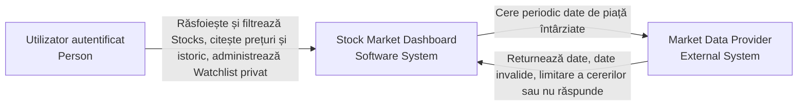
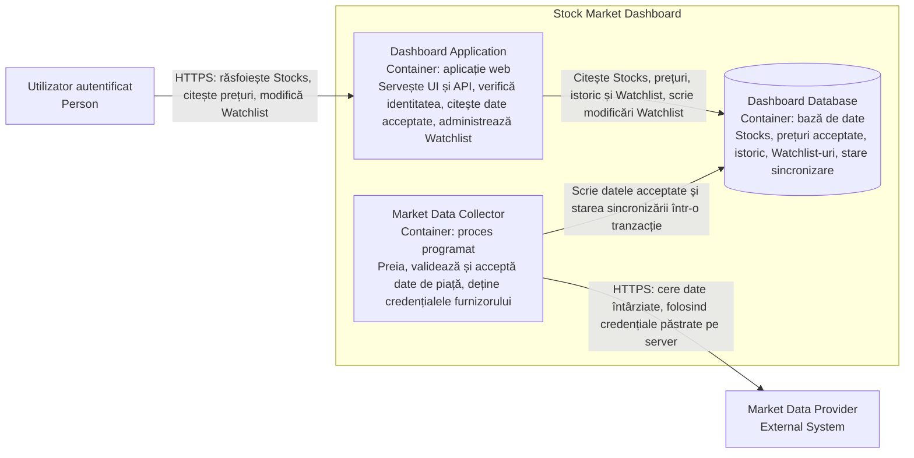
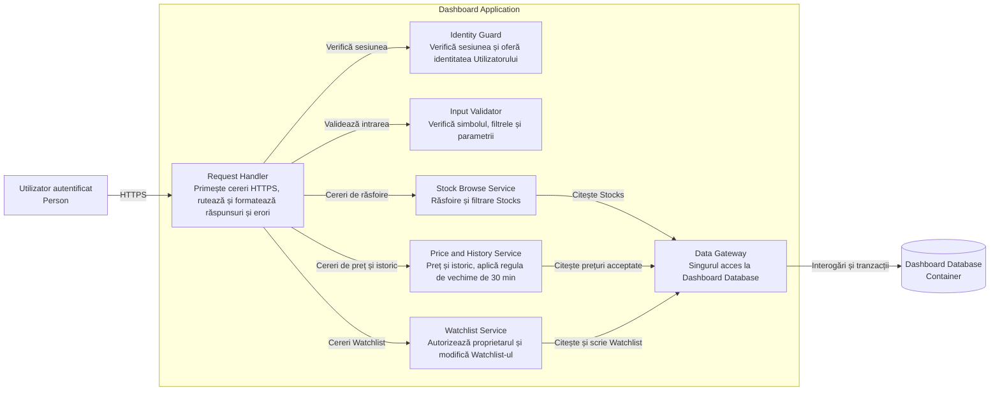
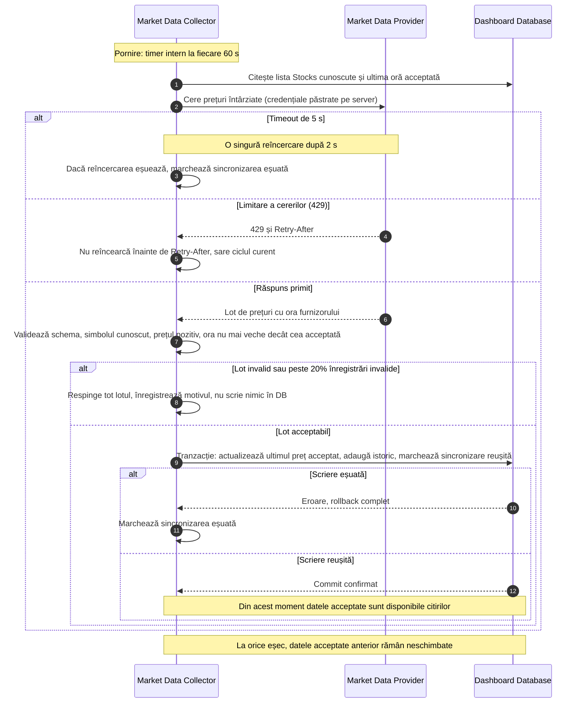
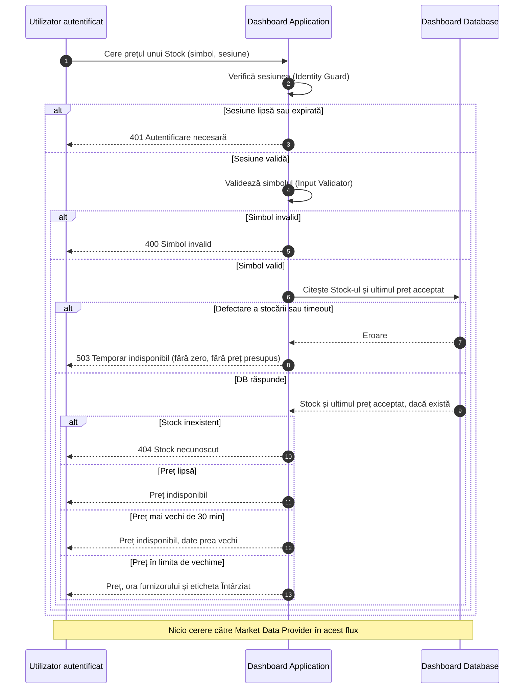
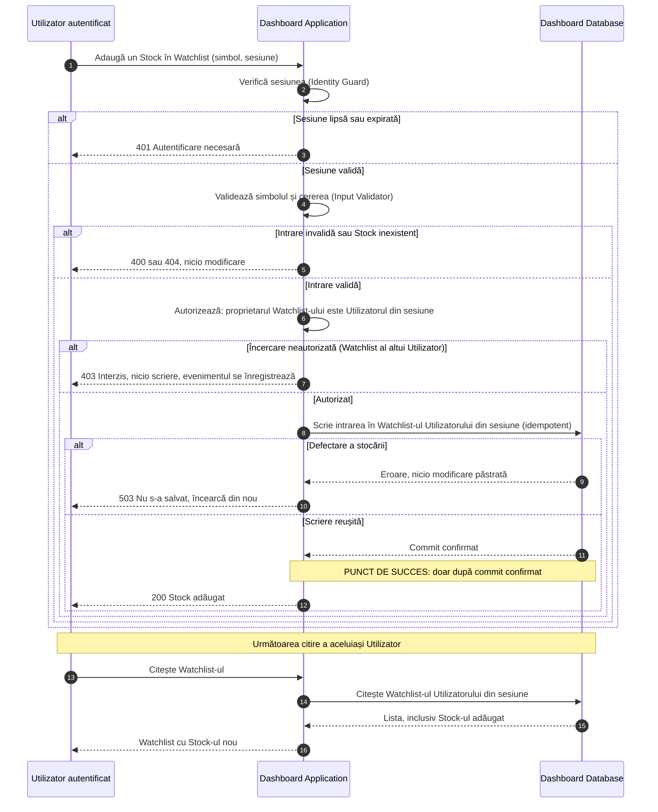

# Laborator 3: Desenează limita Dashboard-ului

## 0. Analiza cerinței (pe scurt)

| Ce cere laboratorul | Puncte importante |
| --- | --- |
| 3 diagrame de arhitectură (Context, Container, Component) | Fiecare nivel „deschide" un singur element din nivelul de deasupra. Component deschide **doar** Dashboard Application. |
| 3 diagrame de secvență (A, B, C) | Participanții sunt cei din Container (nume identice peste tot). Fiecare are `alt` pentru succes, respingere și defectare, plus ipoteze dedesubt. |
| Folosește țintele de volum din Laboratorul 2 | Se folosește modelul din Lecția 3 (1,000 Utilizatori concurenți, 234 RPS stabil, 310 RPS la deschiderea pieței). **Dacă Laboratorul 2 conține alte cifre, acestea se înlocuiesc în secțiunea 1.** |
| Cel mai mic set de containere | Nu se adaugă cache, coadă, replici sau serviciu de autentificare separat: nu există dovezi că volumul le cere. |
| Furnizorul poate da date invalide, poate limita cererile sau poate fi căzut | Cerința centrală: **citirile Utilizatorului nu apelează furnizorul**. Doar un proces separat de sincronizare vorbește cu el. |

### Decizii de proiectare luate (și motivul)

1. **Market Data Collector este container separat** de Dashboard Application. Motive: (a) volumul către furnizor nu depinde de numărul de Utilizatori (1 cerere la 60 s, nu 234 RPS), (b) o defectare a furnizorului nu rupe răsfoirea, (c) doar Collector deține credențialele furnizorului, deci nu ajung niciodată în browser.
2. **Dashboard Database** este singura stocare: Stocks, ultimul preț acceptat, istoric, Watchlist-uri, starea sincronizării. Este și punctul de adevăr pentru „datele acceptate".
3. **Autentificarea rămâne în Dashboard Application** (sesiune verificată de un component `Identity Guard`). Un serviciu separat nu e justificat la 1,000 de Utilizatori.
4. **Regulă de vechime:** un preț acceptat se afișează cu ora furnizorului și eticheta „întârziat" cât timp are cel mult **30 de minute** de la ora furnizorului. Peste limită: „indisponibil". Nu se afișează niciodată zero și un preț vechi nu e prezentat ca fiind curent.

---

## 1. Volum de lucru folosit (ipoteze)

Ipoteze preluate din modelul Dashboard al Lecției 3. Cifrele pentru scrieri sunt o ipoteză a proiectării.

| Flux | Calcul | Rezultat |
| --- | --- | --- |
| Overview | `1,000 x 0.70 / 30` | 23.33 RPS |
| Stock price | `1,000 x 0.20 x 1` | 200 RPS |
| Watchlist read | `1,000 x 0.60 / 60` | 10 RPS |
| **Citiri, regim stabil** | `23.33 + 200 + 10` | **233.33 -> 234 RPS** |
| **Citiri, deschiderea pieței** | `(233.33 + 30 + 18) x 1.10` | **309.47 -> 310 RPS** |
| Scrieri Watchlist (ipoteză) | `1,000 x 0.05 / 60` stabil, vârf aprox. 3x | aprox. 1 RPS stabil, 3 RPS vârf |
| Cereri către furnizor | 1 sincronizare / 60 s (+ cel mult o reîncercare) | aprox. 1-2 cereri/minut, **independent de Utilizatori** |

Observație: Stock price este aprox. 86% din citirile în regim stabil, deci este prima ipoteză de blocaj de măsurat. Nu e un blocaj dovedit.

Ținte de calitate folosite în diagrame (exemple, de ajustat cu Lab 2):

- Citire Stock price, în interiorul sistemului, la 310 RPS: p95 <= 300 ms.
- Disponibilitate răsfoire/citire: 99.9% în 30 de zile (buget: 43 min 12 s).
- Modificare Watchlist, observată de Client: p95 <= 1,500 ms.
- Consistență Watchlist: după succes confirmat, următoarea citire a aceluiași Utilizator arată modificarea.

---

## 2. Diagrama System Context

Arată doar limita sistemului, actorii și sistemele externe. Fără părți interne.

---

## 3. Diagrama Container

Diagrama deschide limita sistemului: trei containere, fiecare cu o responsabilitate.

**De ce acest set minim:**

- Dashboard Application nu apelează niciodată furnizorul: o citire a Utilizatorului nu cere o cerere nouă către furnizor.
- Collector și Dashboard Application comunică **doar prin Dashboard Database**, deci nu depind unul de altul la execuție.
- Nu se adaugă cache, coadă sau replici: 310 RPS de citire și aprox. 3 RPS de scriere nu justifică încă aceste mecanisme. Lipsesc măsurătorile care le-ar susține.

---

## 4. Diagrama Component (Dashboard Application)

Se deschide numai Dashboard Application. Componentele sunt responsabilități, nu clase sau funcții. Market Data Collector nu apare, fiind container lansat separat, iar furnizorul nu comunică direct cu aplicația.

---

## 5. Diagrame de secvență

### A. Sincronizează datele de piață

**Ipoteze:**

- Sincronizarea rulează la 60 s. Furnizorul oferă date întârziate (aprox. 15 min), deci o frecvență mai mare nu aduce date mai noi.
- Datele devin vizibile citirilor **numai după commit**. Un lot parțial scris nu este vizibil (tranzacție atomică).
- Înregistrările invalide sunt: simbol necunoscut, preț lipsă sau <= 0, schemă greșită, oră mai veche decât cea deja acceptată. Peste 20% invalide, tot lotul este respins (probabil defect la furnizor).
- La eșec (timeout, 429, lot invalid, DB), **ultimele date acceptate rămân** și continuă să fie servite cu eticheta de întârziere, până la limita de 30 min de la ora furnizorului. Apoi citirea răspunde „indisponibil".
- Cheia furnizorului este doar în mediul serverului Collector. Nu ajunge în browser, în Dashboard Application sau în răspunsuri.
- Eșecurile se înregistrează în log și în starea sincronizării, pentru alertare.

---

### B. Citește prețul unui Stock

**Ipoteze:**

- **O citire a Utilizatorului NU cere o cerere nouă către furnizor.** Citește doar ultimul preț acceptat din Dashboard Database, scris de Market Data Collector.
- Limita maximă de vechime este 30 min față de ora furnizorului (aprox. 15 min întârziere normală + marjă pentru 1-2 sincronizări ratate).
- Un preț vechi peste limită nu se afișează ca preț curent, iar lipsa unui preț nu se afișează ca zero.
- Ținta: p95 <= 300 ms la 310 RPS. O defectare a stocării dă 503, nu un rezultat inventat.

---

### C. Modifică un Watchlist privat

Operația exemplu este adăugarea unui Stock în Watchlist-ul propriu.

**Ipoteze:**

- Identitatea proprietarului vine **numai din sesiune**, nu din parametrii cererii. Dacă cererea indică Watchlist-ul altui Utilizator, răspunsul este 403 și nu se scrie nimic.
- Verificările se fac în ordinea: identitate -> intrare -> permisiune -> scriere.
- Succesul se raportează **doar după commit confirmat**. La defectare, Utilizatorul primește eroare, nu succes, și nu rămâne o modificare parțială.
- Adăugarea este idempotentă: a adăuga același Stock a doua oară nu creează duplicat și nu dă eroare.
- **Consistență (read-your-writes):** după un succes confirmat, următoarea citire a aceluiași Utilizator arată Stock-ul adăugat. Se citește din aceeași bază, fără replică sau cache care ar putea întârzia.
- Watchlist-ul este privat: nicio citire nu returnează date ale altui Utilizator.
- Ștergerea din Watchlist urmează același flux, cu aceeași regulă: la citirea următoare, Stock-ul nu mai apare.

---
