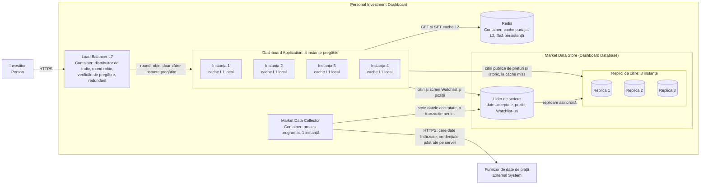
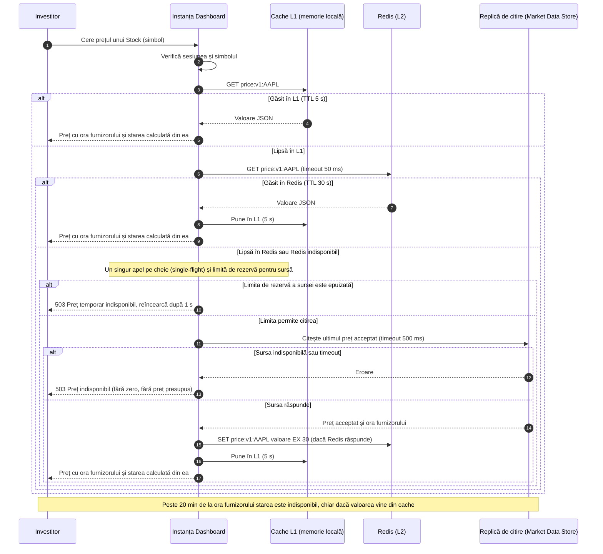
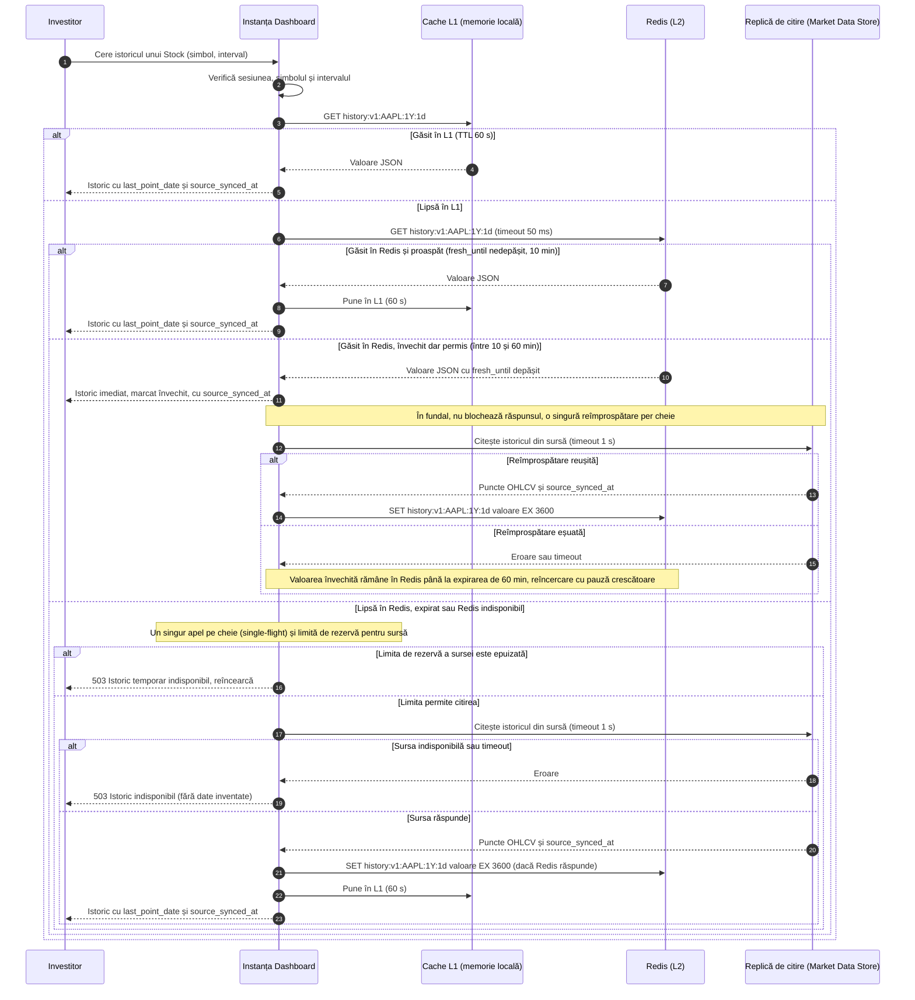

# Laboratorul 4: Scalează traseul de citire al Dashboard-ului — Soluție

**Ipoteze de lucru (din enunț):**

- La 3,000 de Utilizatori, citirile **Stock price** sunt 600 RPS (Laboratorul 2). În acest laborator se folosește o **marjă de 20%**, nu cea de 10% din Laboratorul 2.
- O instanță Dashboard gestionează în siguranță **250 RPS** de prețuri. Cifra vine din enunț; nu am avut Lecția 5 la îndemână ca să verific setările HPA, deci o iau ca dată.
- Market Data Store: o **replică de citire** servește **400 RPS**; **liderul** de scriere nu intră în capacitatea pentru citiri publice.
- La dimensionare **nu presupun nicio rată de găsire în cache**: instanțele și replicile trebuie să ducă tot traficul cu L1 și Redis goale.

---

## 1. Scalează serviciul și rutează cererile

### 1.1 Numărul de instanțe Dashboard

```text
Țintă cu marjă                 = 600 x 1.20 = 720 RPS
Instanțe pentru a duce sarcina = ceil(720 / 250) = ceil(2.88) = 3
Cu pierderea unei instanțe     = 3 + 1 = 4 instanțe pregătite
```

Verificare:

```text
4 instanțe pregătite           -> 4 x 250 = 1,000 RPS
după oprirea uneia (3 rămase)  -> 3 x 250 =   750 RPS >= 720  OK (30 RPS peste țintă)
3 instanțe, după oprirea uneia -> 2 x 250 =   500 RPS <  720  NU ajunge
```

**Rezultat: 4 instanțe Dashboard pregătite**, ca minim. Autoscalarea poate adăuga instanțe peste 4, dar nu coboară sub 4. O instanță contează doar dacă trece verificarea de pregătire (readiness).

### 1.2 Distribuirea traficului

**Alegere: nivel L7 (HTTP), metodă round robin**, cu verificări active de pregătire și un distribuitor redundant (cel puțin 2 noduri sau serviciu gestionat, ca să nu fie el însuși punct unic de defectare).

**De ce se potrivește:**

- Cererile Stock price au cost similar, iar instanțele sunt identice (250 RPS fiecare). Round robin le împarte egal, fără calcule suplimentare.
- Instanțele sunt fără stare (vezi 1.3), deci nu e nevoie ca același client să ajungă mereu la aceeași instanță. De aceea **hash după IP-ul clientului nu are sens**: mai mulți clienți în spatele aceluiași NAT ar încărca o singură instanță.
- „Cele mai puține conexiuni" ar ajuta dacă duratele cererilor ar fi foarte diferite; aici nu sunt.
- L7 vede codul de răspuns HTTP, face verificări de pregătire (de exemplu pe `/ready`), poate reîncerca o cerere `GET` (idempotentă) pe altă instanță și termină TLS.

**Limita principală:** round robin nu ține cont de încărcarea reală. O instanță lentă (pornire la rece, pauză de colectare a memoriei) primește tot atâtea cereri ca celelalte, până când verificarea de pregătire o scoate din rotație. În acest interval latența p95 poate crește. Se reduce prin verificări frecvente, un timeout pe cerere și o reîncercare pe altă instanță pentru `GET`.

**Limită secundară:** aceeași cheie ajunge la toate cele 4 instanțe, deci fiecare își încălzește cache-ul L1 separat. Asta scade rata de găsire în L1 și este un motiv pentru care există și Redis (L2).

### 1.3 Starea după pierderea unei instanțe Dashboard

| Date | Unde trăiesc | După pierderea instanței |
| ---- | ------------ | ------------------------ |
| Poziții și Watchlist-uri | Market Data Store, liderul (Dashboard Database) | Rămân. O modificare este confirmată doar după commit (Laboratorul 3). |
| Prețuri acceptate, istoric, ora furnizorului, starea sincronizării | Market Data Store | Rămân. |
| Sesiunea Investitorului | Token semnat, verificabil de orice instanță (sau stocată în baza de date), **nu doar în memoria unei instanțe** | Rămâne. Altfel Investitorul ar fi deconectat. Aceasta precizează ce lăsase deschis Laboratorul 3. |

**Date temporare care pot rămâne în memoria instanței (și pot fi pierdute):**

- intrările cache L1 (se reconstruiesc din Redis sau din Market Data Store);
- cererile în curs de procesare. Citirile sunt idempotente și distribuitorul le reîncearcă. O scriere Watchlist neconfirmată dă eroare, iar Investitorul o poate relua fără duplicat (adăugarea este idempotentă);
- contoare și metrici locale.

---

## 2. Scalează Market Data Store

### 2.1 Dimensionarea

Cazul cel mai rău pentru stocare este cache gol (L1 și Redis): toate cele 720 RPS ajung la sursă.

```text
Citiri publice de preț la sursă (cache gol) = 720 RPS
Replici pentru sarcină    = ceil(720 / 400) = 2        (2 x 400 = 800 >= 720)
Cu pierderea unei replici = 2 + 1 = 3 replici          (după pierdere: 2 x 400 = 800 >= 720)
Lider = 1 nod, rezervat pentru scrieri și citiri care cer cea mai recentă valoare
        (NU intră în capacitatea pentru citiri publice)

Capacitate publică de citire: 3 x 400 = 1,200 RPS (toate sănătoase), 800 RPS (una pierdută)
```

**Rezultat: 1 lider + 3 replici de citire = 4 noduri.** Dacă liderul cade și se promovează o replică, rămân 2 replici de citire (800 RPS >= 720): ținta se păstrează, dar scrierile (Collector, Watchlist) se opresc pe durata comutării. Citirile continuă, iar prețurile rămân utilizabile până la limita de 20 de minute.

**Notă de domeniu:** dimensionarea acoperă numai citirile Stock price, cum cere enunțul. Celelalte citiri din Laboratorul 2 (Overview, History, Filter, Search) adaugă încărcare la replici și trebuie verificate separat.

### 2.2 Rutarea citirilor și replicarea

| Citire sau scriere | Merge la | Motiv |
| ------------------ | -------- | ----- |
| Stock price, History (publice) | L1, apoi Redis, apoi **replici** | Date publice, tolerează o mică întârziere de replicare |
| Watchlist (citire și scriere), poziții | **Liderul**, fără cache | Păstrează „citirea propriilor scrieri" din Laboratorul 2 |
| Scrierile Market Data Collector | **Liderul** | Un singur scriitor, o tranzacție per lot |

- Citirile Watchlist la 3,000 de Utilizatori sunt cel mult 30 + 54 = 84 RPS (Laboratorul 2, regim stabil plus deschiderea pieței). Ele merg la lider și nu se numără în cei 1,200 RPS ai replicilor. Este o ipoteză: liderul poate duce acest volum alături de scrieri.
- Replicarea este asincronă. **Ipoteză:** întârzierea normală este sub 5 s; o replică cu întârziere peste 30 s iese din rotație (se numără ca replică pierdută).
- Întârzierea de replicare nu poate face un preț să pară mai nou. Vechimea se calculează din ora furnizorului, deci replicarea întârziată doar îl face să pară mai vechi.

### 2.3 Container View actualizat



---

## 3. Pune în cache două citiri publice

Cele două cazuri sunt **Stock price** (TTL simplu) și **History** (stale-while-revalidate). Ambele sunt date publice: nicio cheie sau valoare nu conține identitatea Utilizatorului, poziții sau Watchlist-uri, deci o intrare servește toți Utilizatorii.

### 3.1 Cazul A: Stock price

**Munca repetată eliminată:** același preț acceptat, pentru același simbol, ar fi citit de la replică și serializat la fiecare cerere, deși se schimbă cel mult o dată pe 60 s (ciclul de sincronizare). Dimensionarea din secțiunea 2 **nu** se bazează pe această reducere.

| Decizie | Stock price |
| ------- | ----------- |
| Cheie și valoare | Cheie `price:v1:{symbol}`, de exemplu `price:v1:AAPL` (`v1` = versiunea schemei). Valoare JSON: `symbol`, `last_price`, `change_abs`, `change_pct`, `provider_time`, `sync_time`, `cached_at`, `schema`. **Nu** include starea (curent/învechit): ea se calculează la fiecare citire din `provider_time`. Nicio dată a Utilizatorului. |
| Sursă | Ultimul preț acceptat din Market Data Store (replici de citire), scris de Collector. Poate reconstrui complet un cache gol. |
| Durată de viață L1 | **5 s** în memoria fiecărei instanțe |
| Durată de viață Redis | **30 s** |
| Actualitate | **TTL simplu.** Limitele de vechime rămân cele din Laboratoarele 2 și 3, calculate din `provider_time`: sub 16 min = „Întârziat 15 min" (actual); 16 până la 20 min = „Învechit"; peste 20 min = „indisponibil". O intrare cu TTL expirat nu se servește. |
| Rezultat la defectare | Vezi tabelul de mai jos |

**Verificarea duratei de viață față de politica datelor:**

```text
Marjă pentru date = 20 min (limita) - 15 min (întârzierea furnizorului) - 1 min (ciclu de sincronizare) = 4 min = 240 s
Întârziere adăugată de cache = 30 s (Redis) + 5 s (L1) = 35 s, adică ~15% din marjă
```

Cache-ul nu face un preț să pară mai nou: eticheta vine din `provider_time`, nu din `cached_at`. În cazuri rare, cei 35 s pot muta un preț din „Întârziat" în „Învechit" cu puțin mai devreme. Este acceptat.

**De ce TTL simplu aici:** prețul se schimbă la 60 s, iar un preț expirat nu trebuie arătat ca și cum ar fi actual. Stale-while-revalidate ar prelungi tocmai riscul de a arăta un preț vechi.

**Rezultat la defectare (Stock price):**

| Ce se defectează | Ce vede Utilizatorul |
| ---------------- | -------------------- |
| Intrare lipsă în L1 (repornirea instanței) | Nimic diferit: citire din Redis sau din sursă, uneori puțin mai lent |
| Redis indisponibil | Nimic diferit: citire direct din replici, în limita de rezervă din 3.3. La depășirea limitei: „Preț temporar indisponibil, reîncearcă" (503) |
| Sursa (replicile) indisponibilă, cache gol | „Preț indisponibil". Niciodată zero, niciodată un preț presupus |
| Sursa indisponibilă, dar există valoare în L1 sau Redis | Prețul din cache, cu ora furnizorului și starea calculată din ea; peste 20 min de la ora furnizorului devine „indisponibil" |
| Furnizorul extern căzut | Se servește ultimul preț acceptat cu starea potrivită vechimii; peste 20 min „indisponibil" |

**Secvență: citire Stock price din cache**



### 3.2 Cazul B: History

**Munca repetată eliminată:** fiecare citire a istoricului ar interoga și serializa până la 365 de puncte zilnice pentru un interval de 1 an (365 x 70 B ≈ 25 KB, cu dimensiunea de 70 B per punct din Laboratorul 2), deși istoricul primește un singur punct nou pe zi.

| Decizie | History |
| ------- | ------- |
| Cheie și valoare | Cheie `history:v1:{symbol}:{range}:{granularity}`, de exemplu `history:v1:AAPL:1Y:1d`. Intervalul și granularitatea sunt în cheie, pentru că schimbă rezultatul. Valoare JSON: `symbol`, `range`, `granularity`, `points` (data, open, high, low, close, volum), `last_point_date`, `source_synced_at`, `cached_at`, `fresh_until`, `schema`. Nicio dată a Utilizatorului. |
| Sursă | Setul Price history din Market Data Store (replici de citire) |
| Durată de viață L1 | **60 s** (sub fereastra proaspătă de 10 min) |
| Durată de viață Redis | **3,600 s** (limita de expirare); prospețimea se ține în `fresh_until`, nu în TTL |
| Actualitate | **Stale-while-revalidate.** Proaspăt: până la 10 min de la `cached_at`. Învechit permis: de la 10 la 60 min, se servește imediat și se reîmprospătează în fundal. Expirat: peste 60 min, Redis șterge cheia și se citește sursa. |
| Rezultat la defectare | Vezi tabelul de mai jos |

**De ce stale-while-revalidate aici:** istoricul se schimbă o dată pe zi, după sincronizarea de după închiderea pieței. O oră de vechime nu ascunde nicio zi de tranzacționare, iar Utilizatorul primește imediat un răspuns, nu așteaptă citirea de 25 KB. Răspunsul conține mereu `last_point_date` și `source_synced_at`, deci vechimea se vede. Limitele de 10 și 60 min sunt ipoteze noi: Laboratorul 2 nu fixase o regulă de actualitate pentru History.

**Rezultat la defectare (History):**

| Ce se defectează | Ce vede Utilizatorul |
| ---------------- | -------------------- |
| Intrare lipsă în L1 | Nimic diferit: citire din Redis sau din sursă |
| Redis indisponibil | Citire directă din replici, în limita de rezervă; la depășire: „Istoric temporar indisponibil" (503) |
| Reîmprospătarea din fundal eșuează | Utilizatorul primește în continuare valoarea învechită permisă (cu `source_synced_at`), până la expirarea de 60 min; reîncercarea se face cu pauză crescătoare |
| Sursa indisponibilă, nimic în cache sau expirat | „Istoric indisponibil". Fără puncte inventate |

**Secvență: citire History din cache (stale-while-revalidate)**



### 3.3 Încărcare în avans și acces de rezervă la sursă

**Seturile încărcate în avans (limitate):**

| Set | Chei | Alegere |
| --- | ---- | ------- |
| Prețuri | Primele **500** de simboluri după volumul mediu (`avg_volume`, deja stocat pentru Filter) | 500 de chei x ~300 B ≈ 150 KB |
| Istoric | Aceleași **100** de simboluri din top, doar intervalul `1Y` cu granularitate `1d` | 100 de chei |

Nu se încarcă toate cele 5,700 de simboluri: restul se umplu la cerere, în limita de rezervă de mai jos.

**Reguli cu limite:**

| Aspect | Regulă |
| ------ | ------ |
| Când | Istoric: la 09:00 ET. Prețuri: la 09:29 ET, cu puțin înainte de deschidere, pentru că TTL-ul Redis este de 30 s. **După recuperare** (Redis repornit sau gol): imediat, în aceeași ordine (prețuri, apoi istoric) |
| Cine | O singură instanță, aleasă prin `SET warm:lock <id> NX EX 60`. Dacă Redis este indisponibil, încărcarea nu rulează (este doar optimizare) |
| Cum | Prețuri: loturi de 50 de chei într-o singură interogare pe lot, cel mult 2 loturi în paralel (cel mult 10 interogări în total). Istoric: o cheie per interogare, cel mult 2 în paralel |
| Buget | Cel mult ~10% din capacitatea publică a replicilor (80 RPS echivalent). Se oprește dacă replicile depășesc ținta de latență sau întârzierea de replicare depășește 30 s. Timp maxim: 30 s pentru prețuri, 2 min pentru istoric |

**Accesul de rezervă la sursă (când L1 și Redis nu au valoarea):**

```text
Limita globală de rezervă = 760 RPS
  (sub cei 800 RPS ai celor 2 replici rămase după pierderea uneia, peste cei 720 RPS ai țintei)
Limită per instanță = min(250, 760 / instanțe pregătite)
  4 instanțe pregătite -> 190 RPS per instanță (total 760)
  3 instanțe pregătite -> min(250, 253) = 250 RPS per instanță (total 750 >= 720)
```

La acestea se adaugă: un singur apel pe cheie și pe instanță (single-flight), timeout de 500 ms pentru preț și 1 s pentru istoric (de aceea o sursă lentă nu blochează instanța), iar apelurile către Redis au timeout de 50 ms, cu întrerupător (circuit breaker) care sare Redis 10 s după 5 eșecuri consecutive.

**Ce vede Utilizatorul:**

| Situație | Rezultat vizibil |
| -------- | ---------------- |
| Încărcare în avans incompletă | Nimic greșit: cheile lipsă se citesc din sursă, în limita de rezervă. Primele citiri pot fi mai lente |
| Limita de rezervă epuizată | Pentru cererile peste limită: „Preț temporar indisponibil, reîncearcă" (503, `Retry-After: 1`). În Overview și Watchlist rândul respectiv arată „preț indisponibil", iar restul listei rămâne vizibil. Niciodată zero, niciodată un preț vechi prezentat ca actual |
| Sursa indisponibilă | „Preț indisponibil" sau „Istoric indisponibil", cu excepția valorilor din cache încă permise |

---

## 4. Implementează traseul cache-ului Redis prin comenzi

Transcrierile de mai jos au fost rulate local cu `redis-server` 7.0.15, pornit cu `--port 6399 --save "" --appendonly no` (de aceea promptul arată portul 6399). Valorile JSON sunt ilustrative. `TTL` a fost verificat după aproximativ 4 secunde, de aceea nu arată valoarea completă. Pașii urmează ordinea din enunț: `GET` (lipsă), citirea sursei durabile (diagramele de secvență), `SET ... EX`, `GET` (găsit), `TTL`.

### 4.1 Cazul A: Stock price

Valoarea JSON stocată la `price:v1:AAPL`:

```json
{
  "symbol": "AAPL",
  "last_price": 230.00,
  "change_abs": 1.15,
  "change_pct": 0.50,
  "provider_time": "2026-09-29T14:15:00Z",
  "sync_time": "2026-09-29T14:30:00Z",
  "cached_at": "2026-09-29T14:31:07Z",
  "schema": 1
}
```

`provider_time` (observația furnizorului), `sync_time` (preluarea în Dashboard) și `cached_at` (punerea în Redis) sunt momente diferite și rămân separate.

```text
$ redis-cli -p 6399 PING
PONG

127.0.0.1:6399> GET price:v1:AAPL
(nil)

(sursa durabilă: Dashboard citește ultimul preț acceptat din replică, vezi diagrama 3.1)

127.0.0.1:6399> SET price:v1:AAPL '{"symbol":"AAPL","last_price":230.00,"change_abs":1.15,"change_pct":0.50,"provider_time":"2026-09-29T14:15:00Z","sync_time":"2026-09-29T14:30:00Z","cached_at":"2026-09-29T14:31:07Z","schema":1}' EX 30
OK

127.0.0.1:6399> GET price:v1:AAPL
"{\"symbol\":\"AAPL\",\"last_price\":230.00,\"change_abs\":1.15,\"change_pct\":0.50,\"provider_time\":\"2026-09-29T14:15:00Z\",\"sync_time\":\"2026-09-29T14:30:00Z\",\"cached_at\":\"2026-09-29T14:31:07Z\",\"schema\":1}"

127.0.0.1:6399> TTL price:v1:AAPL
(integer) 26
```

### 4.2 Cazul B: History

Valoarea JSON stocată la `history:v1:AAPL:1Y:1d` (lista `points` este scurtată la 2 puncte, pentru lizibilitate):

```json
{
  "symbol": "AAPL",
  "range": "1Y",
  "granularity": "1d",
  "points": [
    {"d": "2026-09-25", "o": 227.80, "h": 229.90, "l": 227.10, "c": 228.85, "v": 45100000},
    {"d": "2026-09-28", "o": 228.90, "h": 231.40, "l": 228.10, "c": 229.85, "v": 48200000}
  ],
  "last_point_date": "2026-09-28",
  "source_synced_at": "2026-09-28T20:30:00Z",
  "cached_at": "2026-09-29T14:31:09Z",
  "fresh_until": "2026-09-29T14:41:09Z",
  "schema": 1
}
```

Aici `fresh_until` (10 min) este separat de TTL-ul Redis (3,600 s, limita de expirare).

```text
127.0.0.1:6399> GET history:v1:AAPL:1Y:1d
(nil)

(sursa durabilă: Dashboard citește punctele din Price history, vezi diagrama 3.2)

127.0.0.1:6399> SET history:v1:AAPL:1Y:1d '{"symbol":"AAPL","range":"1Y","granularity":"1d","points":[{"d":"2026-09-25","o":227.80,"h":229.90,"l":227.10,"c":228.85,"v":45100000},{"d":"2026-09-28","o":228.90,"h":231.40,"l":228.10,"c":229.85,"v":48200000}],"last_point_date":"2026-09-28","source_synced_at":"2026-09-28T20:30:00Z","cached_at":"2026-09-29T14:31:09Z","fresh_until":"2026-09-29T14:41:09Z","schema":1}' EX 3600
OK

127.0.0.1:6399> GET history:v1:AAPL:1Y:1d
"{\"symbol\":\"AAPL\",\"range\":\"1Y\",\"granularity\":\"1d\",\"points\":[{\"d\":\"2026-09-25\",\"o\":227.80,\"h\":229.90,\"l\":227.10,\"c\":228.85,\"v\":45100000},{\"d\":\"2026-09-28\",\"o\":228.90,\"h\":231.40,\"l\":228.10,\"c\":229.85,\"v\":48200000}],\"last_point_date\":\"2026-09-28\",\"source_synced_at\":\"2026-09-28T20:30:00Z\",\"cached_at\":\"2026-09-29T14:31:09Z\",\"fresh_until\":\"2026-09-29T14:41:09Z\",\"schema\":1}"

127.0.0.1:6399> TTL history:v1:AAPL:1Y:1d
(integer) 3596
```

### 4.3 De ce TTL-ul Redis nu dovedește actualitatea sursei

TTL-ul numără timpul **de la `SET`** (momentul `cached_at`), nu de la observația furnizorului. O cheie scrisă acum o secundă poate conține un preț observat de 15 minute sau mai mult. Mai grav: dacă furnizorul returnează în continuare aceeași observație veche, fiecare rescriere repornește TTL-ul și cheia pare „proaspătă" deși datele nu s-au schimbat. De aceea actualitatea se verifică din `provider_time` (preț) și din `source_synced_at` și `fresh_until` (istoric), iar `cached_at` rămâne un moment distinct. TTL-ul limitează doar cât timp stă o copie în cache.

### 4.4 Alegerea persistenței Redis

**Alegere: fără persistență** (`save ""`, `appendonly no`).

```text
127.0.0.1:6399> CONFIG GET save
1) "save"
2) ""

127.0.0.1:6399> CONFIG GET appendonly
1) "appendonly"
2) "no"

127.0.0.1:6399> SHUTDOWN NOSAVE
(serverul este repornit cu aceleași setări)

127.0.0.1:6399> DBSIZE
(integer) 0

127.0.0.1:6399> GET price:v1:AAPL
(nil)
```

**Motivele:**

- Redis este doar cache: sursa durabilă este Market Data Store, care poate reconstrui orice intrare.
- Prețurile au TTL de 30 s: un snapshot RDB ar fi expirat aproape complet la reîncărcare.
- Pentru istoric (TTL 3,600 s) RDB ar putea reîncărca intrări, dar câștigul este mic: istoricul se reface repede din sursă, iar intrările rămân verificabile prin `fresh_until`.
- RDB sau AOF adaugă scrieri pe disc și o a doua copie de date de gestionat, fără o cerință care să le justifice.

**După ce Redis repornește cu cache gol:** toate cererile `GET` găsesc cheia lipsă (cum arată `DBSIZE 0`). L1 din instanțe mai ține până la 5 s. Apoi citirile merg la replici, în limita de rezervă de 760 RPS, iar încărcarea în avans (3.3) pornește imediat pentru cele 500 de prețuri și cele 100 de istorice. Utilizatorul poate vedea primele răspunsuri mai lente sau, peste limită, „temporar indisponibil". Nu primește date greșite.

---

## 5. Schimbări față de deciziile anterioare

| Decizie anterioară | Ce se schimbă | Motiv |
| ------------------ | ------------- | ----- |
| Laborator 3: o singură Dashboard Database | Lider + 3 replici de citire | Capacitate: 720 RPS cu cache gol, cu o replică pierdută |
| Laborator 3, secvența C: Watchlist citit din aceeași bază, fără replică sau cache | Watchlist și poziții se citesc și se scriu **doar la lider**, fără cache | Păstrează „citirea propriilor scrieri" din Laborator 2 |
| Laborator 3, secvența B: preț citit direct din bază | Preț citit prin L1, apoi Redis, apoi replică | Cache în două niveluri |
| Laborator 3: sesiunea nu era precizată | Token semnat sau stocare durabilă, nu doar în memoria instanței | Instanțe fără stare |
| Laborator 2: marjă de capacitate 10%, 600 RPS la 3,000 Utilizatori | În acest laborator: marjă 20% (720 RPS) | Cerut de enunț |
| Laborator 2: ținte de latență, regula de 20 min, disponibilitate | **Neschimbate.** Cache-ul adaugă cel mult 35 s la vechimea prețului, în marja de 4 min; eticheta se calculează din `provider_time` | Nu se încalcă regula de actualitate |
| Laborator 2: History fără regulă de actualitate | Adăugat: proaspăt 10 min, învechit permis până la 60 min | Necesar pentru stale-while-revalidate |
| Laborator 3: Market Data Collector, 1 instanță | Neschimbat; nu se scalează aici | Scrie doar la lider |

**Limite ale soluției:** cifrele de 250 RPS per instanță și 400 RPS per replică sunt ipoteze didactice din enunț, nemăsurate. Celelalte citiri din Laboratorul 2 nu sunt dimensionate aici. Într-un sistem real, capacitatea și comportamentul la defectare se verifică prin teste de încărcare și de defectare.
